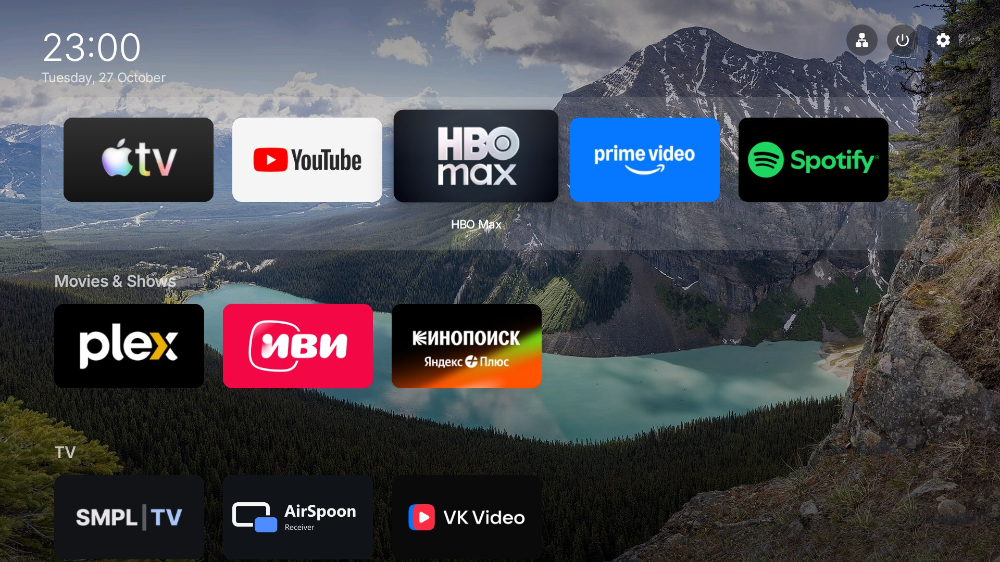
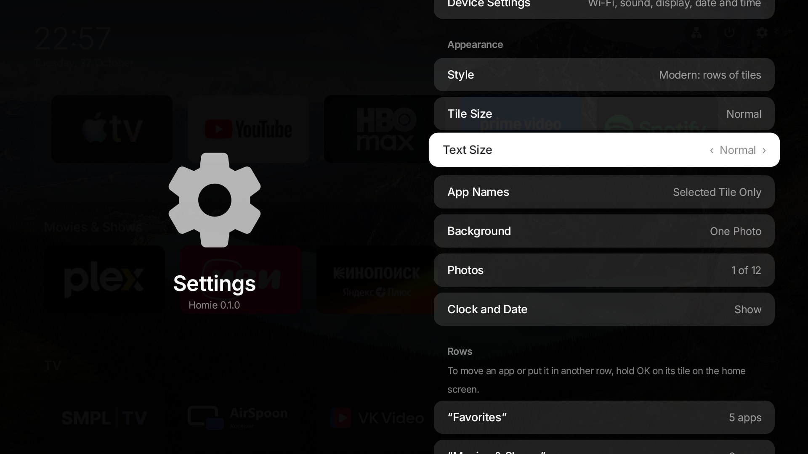
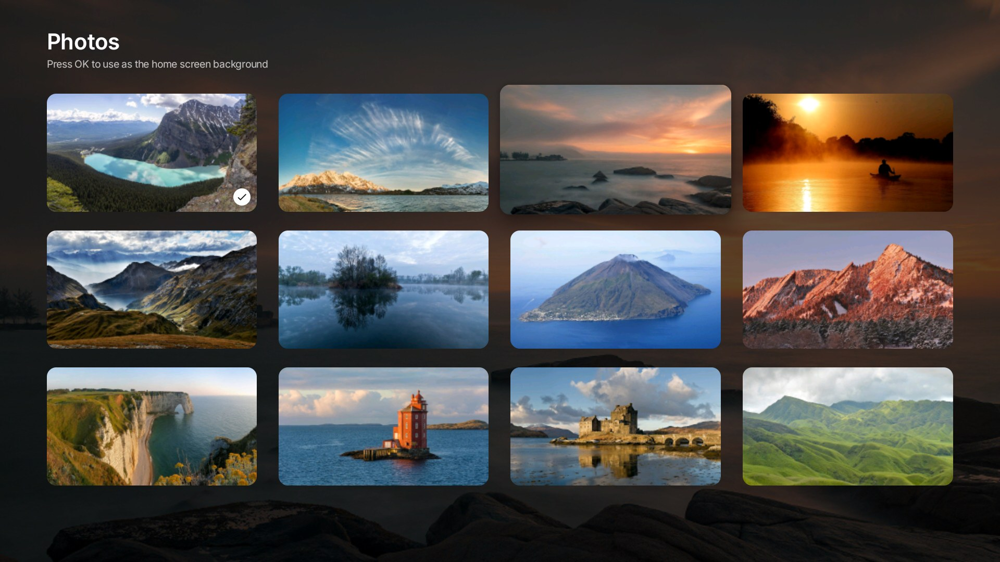
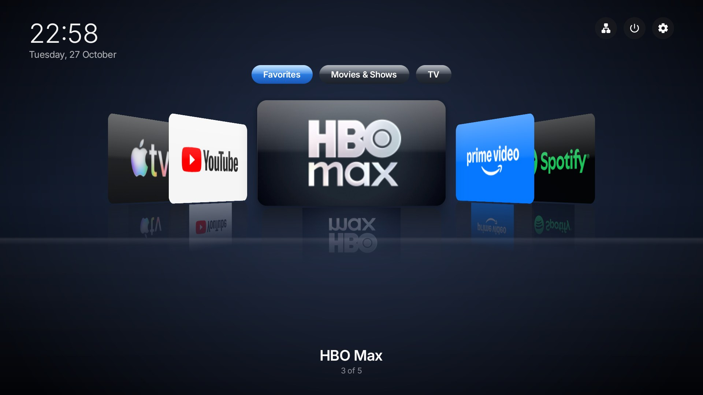
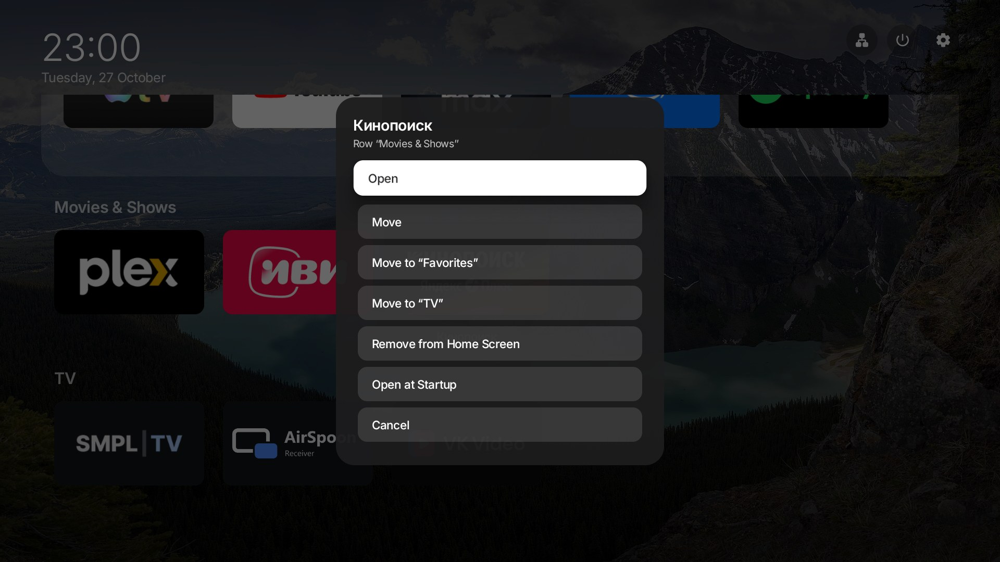
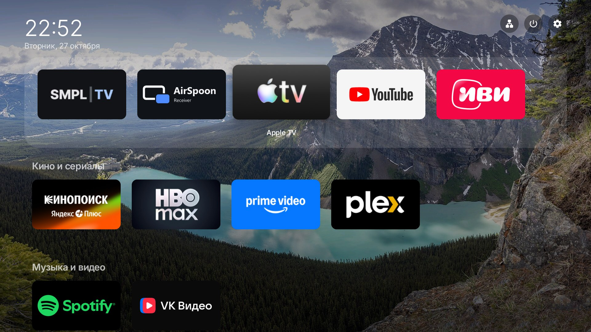

# Homie — Apple TV style launcher for Android TV

**A clean, tvOS‑inspired home screen for Android TV boxes, Google TV and cheap Amlogic / Rockchip
TV boxes.** Replace the cluttered stock Android TV launcher with calm rows of app tiles, smooth
focus animations, a parallax lift and glossy highlight — the way Apple TV feels — all set up with
the remote. No ads, no internet access, no tracking. Free and open source (GPL‑3.0).



| Settings | Wallpaper gallery | Classic cover carousel |
|---|---|---|
|  |  |  |

| Tile menu | Русский интерфейс |
|---|---|
|  |  |

## Features

- **Apple TV / tvOS look on Android TV.** No outlines: the focused tile turns into a lifted card
  with a soft shadow, gentle tilt and a slow specular sheen. Calm, unhurried motion; Inter font
  (an open alternative to SF Pro); neutral dark palette.
- **Your rows, your order.** A dock row on a frosted backing, then your own rows ("TV", "Movies &
  Shows", "Kids"…) and "Other Apps". New apps appear automatically.
- **Everything with the remote.** Hold OK on a tile (or press Menu): move it with the arrows,
  put it into another row, remove it from the home screen, hide it.
- **Two styles.** Modern — rows of tiles. Classic — a Cover Flow‑like carousel with reflections
  on a glossy floor.
- **Big and readable.** Tile size from small to extra large, text size up to extra large —
  good for parents and grandparents.
- **Backgrounds.** Nature photos that change every 10 minutes, one photo from the gallery,
  dark or blue.
- **Status buttons.** Network (Wi‑Fi strength, Ethernet or "no network"), power (sleep,
  restart), settings.
- **Autostart.** Open a chosen app (for example IPTV) automatically after the box boots.
- **Startup screen (root).** Replace the firmware boot logo and boot animation with a clean
  Homie wordmark and a progress bar — or with your own image (`/sdcard/Homie/boot-logo.png`,
  a light picture on a transparent background). Originals are backed up and can be restored
  from Settings. Supported: Amlogic boxes (logo partition) + standard Android boot animation.
- **English and Russian** — follows the system language.
- **Private.** No ads, no analytics, no internet permission.

Works on Android 8.0+ TV devices: Android TV boxes (X96, H96, Tanix, Mecool, Ugoos…),
Chromecast with Google TV, NVIDIA Shield, Xiaomi Mi Box, projectors and TVs with Android TV.

## Install

1. Install the APK from [Releases](../../releases).
2. Press Home on the remote and choose Homie (or in Settings: Apps → Default apps → Home app).
3. For the power button, enable Homie once in Settings → Accessibility. The service only
   performs "sleep" and "power menu" and reads nothing on the screen.

With ADB:

```
adb install homie-<version>.apk
adb shell cmd package set-home-activity ru.iptvsimple.home/.MainActivity
```

## Build

JDK 17 and Android SDK (platform 37):

```
./gradlew :app:assembleRelease
```

## License

Code — GPL‑3.0, see [LICENSE](LICENSE). Inter font — SIL OFL 1.1, see
[FONT-LICENSE.txt](FONT-LICENSE.txt). Background photos — Wikimedia Commons under their own
licenses (CC BY‑SA), authors in [WALLPAPER-CREDITS.md](WALLPAPER-CREDITS.md).

Homie is an independent project, not affiliated with or endorsed by Apple or Google.
Apple TV and tvOS are trademarks of Apple Inc.; Android TV and Google TV are trademarks of
Google LLC. App logos in the screenshots belong to their owners.

---

## По‑русски

**Homie — главный экран в стиле Apple TV для приставок на Android TV.** Заменяет стандартный
лаунчер на спокойные ряды плиток с плавной анимацией фокуса, как на Apple TV. Всё настраивается
пультом. Без рекламы, без интернета, без сбора данных.

- **Ряды приложений.** Первый ряд — «док» на матовой подложке, ниже свои ряды
  («Телевидение», «Кино», «Детям»…) и «Остальные приложения». Новые приложения появляются сами.
- **Всё пультом.** Удерживайте ОК на плитке (или нажмите «Меню»): переставить стрелками,
  перенести в другой ряд, убрать с главного экрана, скрыть.
- **Крупно.** Плитки — от маленьких до очень крупных, надписи — обычные, крупные, очень крупные.
- **Два стиля.** Современный — ряды плиток; Классика — карусель обложек с отражением.
- **Фон.** Фотографии природы (меняются каждые 10 минут) или одна из галереи, тёмный или синий.
- **Автозапуск.** Приложение (например, IPTV), которое откроется само после включения приставки.
- **Заставка при включении (нужен root).** Надпись Homie с полоской загрузки или своя картинка
  (`/sdcard/Homie/boot-logo.png`, светлый рисунок на прозрачном фоне) вместо заставки прошивки.
  Оригиналы сохраняются, «Как в прошивке» возвращает их.

**Установка:** APK из [Releases](../../releases), затем «Домой» на пульте → Homie. Для кнопки
питания один раз включите Homie в «Специальных возможностях».
